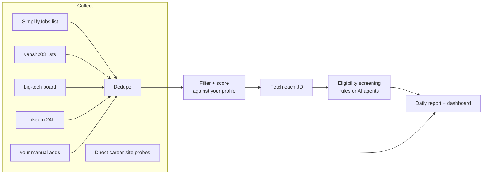
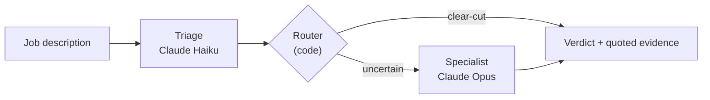

# Internship Agent

**Finds the SWE internships you can actually apply to.** Every day it collects postings from six sources, ranks them against your resume and preferences, and reads each job description to drop the ones your work authorization rules out: no visa sponsorship, US citizens only, or export-controlled (ITAR/EAR) roles.

- **Collects** ~2,600 postings a day from GitHub job lists, a big-tech job board, LinkedIn, and companies' own career sites, deduplicated to ~2,000.
- **Sets itself up from your resume.** Claude reads it and pre-fills your degree, graduation date, skills, and role interests; you confirm, then rank locations and terms.
- **Ranks** what's left by freshness, location, role fit, and graduation-date match, in a daily report and a local dashboard.
- **Screens each job description** with LLM agents (Claude Haiku, escalating to Claude Opus when unsure): 97% accurate on a hand-labeled test set, vs. 67% for keyword rules.



## Quick start

Requires Python 3.10+ and `curl`. Tested on macOS.

```bash
git clone https://github.com/indoortigeryue/internship-agent.git && cd internship-agent
python3 -m venv .venv && .venv/bin/pip install -r requirements.txt
.venv/bin/python setup.py           # answer a few questions → tracker/profile.json
bash tracker/run_daily.sh           # fetch, filter, screen → tracker/reports/<date>.md
bash tracker/open_panel.sh          # dashboard at http://127.0.0.1:8765
```

Run `run_daily.sh` once a day, by hand or from cron. A full run takes about 5 minutes.

## Setup

`setup.py` asks three rounds of questions:

1. **About you.** Your resume (PDF, DOCX, or TXT), your work authorization, degree level, and graduation date, plus how much earlier or later you could graduate (job postings often state a graduation window).
2. **What you're looking for.** Role types, skills, locations in order of preference, which terms you can intern, the recruiting year, whether to hide defense contractors, and how old a posting can be.
3. **Screening engine**, then a review before anything is written.

Resume parsing and AI screening need an [Anthropic API key](https://console.anthropic.com). Setup asks for it only if you choose one of those features, verifies it, and saves it to `.env` with permissions only you can read. Without a key, you type your skills in and screening uses the free rule-based engine.

Your answers live in `tracker/profile.json`. Both it and `.env` are gitignored and never leave your machine. Re-run `setup.py` any time: your previous answers become the defaults. To edit by hand, every field is documented in [`tracker/profile.example.json`](tracker/profile.example.json).

### What your work authorization changes

| Status | Roles without visa sponsorship | US-citizens-only roles | Export-controlled roles |
|---|---|---|---|
| US citizen | shown | shown | shown |
| Permanent resident | shown | hidden | shown |
| F-1 (CPT/OPT), H-1B, other visa | hidden | hidden | hidden |

Degree level works the same way: bachelor's students don't see master's- or PhD-only roles, master's students don't see PhD-only roles, and graduate students don't see undergrad-only roles.

## Choosing a screening engine

Many restrictions only appear inside the job description ("we are unable to sponsor visas", "must be a U.S. person under ITAR"), and they're often hedged ("this position *may* require…"). Two engines read them:

| | Accuracy | Eligible jobs wrongly hidden | Restricted jobs wrongly shown | Cost |
|---|---|---|---|---|
| Rules (keyword patterns) | 67% | 7 of 25 | 6 of 14 | free |
| **AI agents** | **97%** | **0 of 25** | **1 of 14** | ~$0.008 per job, about $0.40/day |

Measured on 39 real postings labeled by hand; details in [docs/EVALUATION.md](docs/EVALUATION.md). Each job description is checked once and cached, so you only pay for new postings.

How the AI engine works:



Haiku reads every job description and must quote the exact sentence behind each decision. A rule-based router checks that the quote really appears in the posting and sends anything ambiguous (hedged export-control language, full-time-only sponsorship clauses, a "nothing found" answer on a page that mentions restrictions) to Opus for a fresh read. About a third of postings get escalated, which keeps Opus-level accuracy at less than half of Opus's cost.

Switch engines by re-running setup, or for a single run with `ENGINE=regex bash tracker/run_daily.sh` (or `ENGINE=cascade`).

## Daily use

### The report

Each posting is scored 0–100: freshness, your location ranking, how well the title matches your target roles and skills, big-tech employers, and whether its graduation window matches yours. The report groups postings into:

- **📍 your first-choice location**: every match, regardless of score
- **🔥 Must apply** (score ≥ 38) and **✅ Worth applying** (20–37)
- **👀 Others**
- **⏳ Not yet handled**: high scorers from earlier days you haven't marked
- **🔥 Watchlist**: openings at companies the job lists don't cover (below)

Mark jobs so they stop coming back:

```bash
python3 tracker/tracker.py --applied "Acme"
python3 tracker/tracker.py --skip "Oracle"
```

If you keep an application log in a spreadsheet, save it as `tracker/applications.xlsx` with a sheet named *Applied* and columns *Company Name*, *Title*, and *Application Date*, and applied jobs are marked automatically.

### The dashboard

`bash tracker/open_panel.sh` opens a local page with filters (location, must-apply, graduation match, LinkedIn, manually added), search, and an apply button on every card. You can **paste a link to add a job** the filters missed, or click **✕ to remove one**. Removed jobs stay removed even when a source re-lists them with a different term suffix or link. The same actions are available from the command line:

```bash
python3 tracker/add_job.py <url> [--note "referral"]
python3 tracker/remove_job.py "Walmart"          # or a URL; --list, --undo
```

### Companies the job lists miss

Some companies never appear in the public lists (Bloomberg, Jane Street, and Stripe had zero entries when tested). [`tracker/watchlist.json`](tracker/watchlist.json) queries those companies' own career sites directly and alerts you in the report the day they open internships. Add your own targets there.

## How it works

- **Sources.** [SimplifyJobs](https://github.com/SimplifyJobs) and vanshb03's Summer internship lists, simplify.jobs' big-tech board (pay, H-1B sponsorship, and requirements for ~1,200 postings), LinkedIn's last 24 hours, and anything you add.
- **Deduplication.** The same job appears under different titles across sources. Postings are matched on company + title with the term and year stripped, and on the job ID inside the application URL.
- **Filtering.** Role type (keyword and word-boundary patterns, with an override so "Backend Engineer Intern – Java & AI" isn't dropped for one "AI"), graduation window, degree level, terms, posting age, location, and the restrictions your status implies. All rules are in your profile.
- **Reading job descriptions.** Most career sites render with JavaScript, but the common applicant-tracking systems (Greenhouse, Workday, Oracle, Ashby, Workable, BambooHR) have public JSON APIs. `verify.py` uses them, which retrieves the full description for about 99% of postings. Sites that block automated access are flagged for a manual look.

## Repo layout

```
setup.py                guided setup → tracker/profile.json
tracker/
  run_daily.sh          the daily pipeline (the one entry point for a scheduler)
  tracker.py            fetch, dedupe, filter, score, write the report
  linkedin.py           LinkedIn source
  watch.py              direct career-site probes (watchlist.json)
  verify.py             fetch each job description, run eligibility screening
  dashboard.py, panel.py  dashboard page and its local server
  add_job.py, remove_job.py, import_applied.py, apply_manual.py
  profile.example.json  every profile field, documented
screener/
  agents.py             the screening agents and router
  llm.py                model calls, caching, cost tracking
  run.py, label.py, evaluate.py, sample.py   evaluation tooling (see docs/EVALUATION.md)
```
