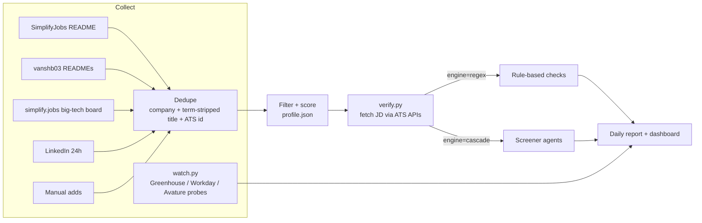
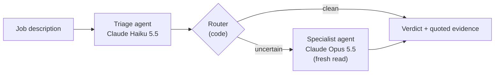

# Internship Agent

**A daily pipeline that collects SWE internship postings from six sources, filters and ranks them against your profile (built from your resume and preferences), and uses a cascaded multi-agent LLM screener to drop roles your work authorization rules out: no visa sponsorship, citizens-only, or export-controlled.**

- **Collects** ~2,600 postings a day from GitHub job lists, a big-tech board, LinkedIn, and companies' own ATS APIs; dedupes them to ~2,000.
- **Onboards** with a guided setup: Claude reads your resume and pre-fills degree, graduation, skills and role interests; you confirm them and rank locations, terms, and role types.
- **Filters and scores** postings against that profile (role type, location, stack, graduation window, degree level, posting age), producing a ranked daily report and a local dashboard.
- **Reads each shortlisted JD** and screens out roles with no visa sponsorship, citizens-only, or export-control (ITAR/EAR) requirements. Screening runs either as regex rules or as **LLM agents**: Claude Haiku triage, with Claude Opus called only when the case is uncertain.

On a blind, hand-labeled held-out set, the agent screener raised apply/skip accuracy **from 67% (regex) to 97%** at **$0.008 per posting**, matching a single Opus call at **59% lower cost**.



## Results: rules vs. agents

39 held-out postings, never seen during development, labeled blind by hand:

| Eligibility screener | Apply/skip accuracy | Eligible jobs wrongly rejected | Restricted jobs wrongly accepted | Cost / posting |
|---|---|---|---|---|
| Regex rules | 67% | 7 / 25 | 6 / 14 | $0 |
| Claude Opus 5.5, single call | 97% | 0 / 25 | 1 / 14 | $0.0205 |
| Claude Haiku 5.5, single call | 95% | 0 / 25 | 2 / 14 | $0.0005 |
| **Cascade (Haiku → Opus when uncertain)** | **97%** | **0 / 25** | **1 / 14** | **$0.0084** |

Method, ablations, and failure analysis are in [Evaluation](#evaluation-the-screener).

---

## Using it

### Setup

```bash
git clone <this repo> && cd internship-agent
python3 -m venv .venv && .venv/bin/pip install -r requirements.txt   # for resume parsing + LLM screening
.venv/bin/python setup.py
```

`setup.py` asks three rounds of questions and writes `tracker/profile.json`:

1. **About you.** Your resume (PDF / DOCX / TXT). With an API key, Claude extracts name, degree, expected graduation, skills, and the role families your experience points to, and every later question is pre-filled from it. Then work authorization, degree level, and how flexible your graduation date is.
2. **What you're looking for.** Role families, skills, locations in order of preference, terms you can intern, recruiting year, whether to hide defense contractors, maximum posting age. Then the **screening engine**: setup shows the measured trade-off (rules: free, 67% correct, wrongly drops 7 of 25 eligible jobs; AI agents: 97%, drops none, ~$0.008 per JD, about $0.40/day at typical volume) and lets you choose.
3. **Review**, then write.

If you pick an AI feature (resume parsing or AI screening), setup asks for an Anthropic API key (hidden input), checks it with a free API call, and stores it in `.env` (gitignored, readable only by you). An `ANTHROPIC_API_KEY` already in your environment is used as-is.

Everything downstream reads that profile: which jobs are filtered out, how they're scored, which area gets its own report section, and which eligibility rules the agents apply. `profile.json` stays on your machine (gitignored); re-run `setup.py` any time, and the previous answers become the defaults. `tracker/profile.example.json` documents every field if you'd rather edit by hand. The tracker itself needs only the Python standard library plus `curl`.

**Work authorization changes what gets screened:**

| Status | No-sponsorship roles | Citizens-only roles | Export-controlled (ITAR/EAR) roles |
|---|---|---|---|
| US citizen | kept | kept | kept |
| Permanent resident | kept | dropped if US citizenship specifically | kept (you're a "US person") |
| F-1 (CPT/OPT), H-1B, other | dropped | dropped | dropped |

Degree level matters too: bachelor's students don't see master's/PhD-only roles, master's students don't see PhD-only roles, and graduate students don't see undergrad-only roles.

### Daily run

```bash
bash tracker/run_daily.sh                    # uses the screening engine you chose in setup
ENGINE=regex bash tracker/run_daily.sh       # override for one run (regex | cascade)
```

| Step | Script | What it does |
|---|---|---|
| 1 | `linkedin.py` | LinkedIn postings from the last 24h (guest API) |
| 2 | `tracker.py` | Fetch all sources, dedupe, filter, score → `reports/<date>.md` |
| 3 | `watch.py` | Probe companies the sources never list, directly on their ATS |
| 4 | `import_applied.py` | Mark jobs as applied from `applications.xlsx` (optional) |
| 5 | `verify.py` | Fetch each shortlisted JD, drop dead links and ineligible roles |
| 6 | `apply_manual.py` | Apply hand-checked verdicts for sites that block scrapers |
| 7 | `dashboard.py` | Render `dashboard.html` |

The pipeline is a single script so it can run unattended on a schedule (cron, or a scheduled agent). A failed step logs and the rest continue.

### The daily report

Each posting gets a 0–100 score: freshness (up to 25) + location weight + stack match from the title (up to 16) + big-tech bonus + graduation-window match + a master's-level bonus. Jobs are bucketed into **preferred location** (listed regardless of score), **must apply** (≥38), **worth applying** (20–37), and **others**, plus **unhandled** (shown before, not yet marked) and **newly opened** (big-tech postings that opened since yesterday).

Mark what you've handled so it stops reappearing:

```bash
python3 tracker/tracker.py --applied "Acme"
python3 tracker/tracker.py --skip "Oracle"
```

### Dashboard

```bash
bash tracker/open_panel.sh        # http://127.0.0.1:8765
```

Filter by location, bucket, or graduation match; every card has an apply link. You can **paste a link to add a job** the filters missed, or **✕ to remove one**. Adds and removes go through `panel.py`, a zero-dependency local server bound to loopback only. Opened as a static file instead, the dashboard queues operations in localStorage and gives you the equivalent CLI commands.

```bash
python3 tracker/add_job.py <url> [--company X --role Y --note "referral"]
python3 tracker/remove_job.py "Walmart"        # or a URL; --undo, --list
```

Manually added jobs skip every filter (you've already decided). Removals are keyed by company + normalized title, so a renamed upstream posting doesn't come back.

### Companies the sources miss

The list sources have systematic gaps: Bloomberg, Jane Street, and Stripe had **zero** entries in either GitHub list when tested. `watchlist.json` defines direct probes against those companies' own ATS (Greenhouse board API, Workday `cxs` JSON endpoint, Avature search with paging). Each probe has a **control query** that must return results, so a broken probe reports "probe failed" instead of looking exactly like "no openings yet".

```bash
python3 tracker/watch.py --dry
```

---

## How it works

### Collection and dedup

| Source | Content |
|---|---|
| SimplifyJobs/Summer2027-Internships | 1,100+ postings, main source |
| vanshb03/Summer2027-Internships + off-season list | ~270 postings, fills gaps; Spring/Fall co-ops |
| simplify.jobs big-tech board | 54 companies, 1,177 postings with pay, H-1B sponsorship flag, JD requirements. The page renders 54, but all 1,177 sit in the embedded `__NEXT_DATA__` JSON, so no browser is needed |
| LinkedIn | Last-24h postings via the guest jobs API |
| Manual | Links added from the dashboard |

The same posting appears under different titles in different sources (`Software Engineer Intern` vs `Software Engineer Intern - Summer 2027`). Dedup keys on company + title with the **term and year stripped**, but not `intern`/`co-op`: Amazon's `SDE Intern` and `SDE Intern/Co-op` are different reqs. Postings with non-overlapping stated terms stay separate. A second pass matches on the **ATS job ID** in the URL, which catches the same Greenhouse job behind two different link formats.

### Filtering

Hard filters drop: no-sponsorship/citizen markers, `sponsors_h1b: false`, defense contractors and clearance keywords, non-SWE roles (keyword + word-boundary regex, so `ai` doesn't match `email`), graduation windows that don't overlap the candidate's, postings older than `max_age_days`, undergrad-only and Canada-only roles. A **strong-signal override** keeps titles like `Backend Software Engineer Intern - Java & AI` that a single "AI" would otherwise drop. Everything is in `profile.json`.

### JD verification (`verify.py`)

The list sources carry titles, not JDs, and sponsorship restrictions usually live only in the JD body. `verify.py` fetches the real posting. Most ATS pages render with JavaScript and come back as empty shells, but nearly all of them have **public JSON APIs**:

| ATS | Endpoint |
|---|---|
| Greenhouse | `boards-api.greenhouse.io/v1/boards/<token>/jobs/<id>`; also recognized behind custom career-site skins via `gh_jid` |
| Workday | `<tenant>.wdN.myworkdayjobs.com/wday/cxs/<tenant>/<site>/job/<path>` (two URL shapes) |
| Oracle Recruiting Cloud | `hcmRestApi/.../recruitingCEJobRequisitionDetails` |
| Ashby / Workable / BambooHR | posting APIs, which also report whether the job is still open |

Adding these took automatic verification from **80.4% to 98.6%** of postings. 403/429 are treated as anti-bot (manual check), never as dead links. Results are cached by URL, so each day only new postings hit the network. The rare sites that block scrapers outright get a hand-checked verdict in `manual_verdicts.json`.

The eligibility decision itself runs through one of two engines. The regex engine is a set of phrase lists with context guards ("may require", full-time-only scoping); the agent engine is described next.

---

## Evaluation: the screener

The regex engine was wrong a third of the time, in ways rules can't fix:

- **It matched text from other jobs.** LinkedIn pages carry a "similar jobs" sidebar; postings were flagged citizens-only because *another* company's listing said "(U.S. Person Required)". That was 8 of 88 dev postings.
- **It can't read hedging.** "This position *may* require export-controlled access" is boilerplate; "This position *requires*…" is a hard requirement. Each new phrasing needed another rule.
- **It misses plain statements** it has no pattern for.

### Agent design



- **Triage** (Haiku, ~$0.0005) returns structured output: a sponsorship value and a citizenship value, each with a **verbatim quote** from the JD.
- **Router** (plain code) escalates when the quote doesn't literally appear in the JD (hallucinated evidence), when the call is nuanced (full-time-only scoping, hedged export language), when triage claims a hard citizenship/ITAR requirement, or when triage found nothing but the JD contains restriction language.
- **Specialist** (Opus, ~$0.02) re-reads the JD from scratch without seeing triage's answer, so it can't anchor on it.

Both agents share one Pydantic schema and one rule set, generated from `profile.json`. Every call is traced (tokens, dollars, latency, escalation reason), and cached by its full request, so experiments are reproducible and re-runs are free.

### The verifier that didn't help

The first design was an **extractor + verifier** loop (evaluator-optimizer), including a **cross-vendor** verifier (Claude extracts, GPT-5.5 audits). On the dev set:

| v1 config (dev, 88 postings) | Apply/skip accuracy | False rejections | False accepts | Cost / posting |
|---|---|---|---|---|
| Opus, single call | 97% | 0 | 3 | $0.019 |
| GPT-5.5, single call | 95% | 0 | 4 | $0.014 |
| Opus + Opus verifier | 97% | 0 | 3 | $0.040 |
| Opus + GPT-5.5 verifier | 94% | 1 | 4 | $0.038 |

Verification **doubled the cost and added nothing**; the cross-vendor verifier overturned one correct answer. The remaining errors were the same across every model and vendor: *"must be a U.S. person… or eligible to obtain the required export authorization"* read as an opening, when for the candidate it effectively isn't. **The errors were correlated:** a verifier with the same rules shares the extractor's blind spot. So I fixed the missing domain rule for all configs, and used multiple agents for **cost** instead of a second opinion. That became the cascade.

### Method

- **Data.** 128 real postings from the tracker, JD text re-fetched through `verify.py`'s ATS fetchers and deduplicated (pages carry the JD twice plus site chrome; trimming halved token cost). The scraped text stays local; `screener/corpus.json` lists the postings.
- **Dev set (88).** Stratified by the regex verdict. Labels: where regex and all pipelines agreed, accepted; all 30 disagreements hand-labeled; 10 agreements spot-checked (10/10). **Rules were revised after error analysis on this set**, so its scores (cascade 100%) are optimistic.
- **Test set (40 → 39).** Sampled after code and prompts were frozen. Labeled **blind** with predictions hidden, every posting by hand, except 12 containing none of the words a restriction can be written with (`sponsor`, `citizen`, `export`, `clearance`, `authoriz`, `visa`, `ITAR`, …); that rule held 20/20 on dev. One UK posting was out of scope.
- **Small n.** 38/39 has a 95% CI of about 87–99%. The ranking is clear; exact percentages aren't.
- **Only the F-1 configuration is evaluated.** The other statuses use the same agents with status-specific rules (see `_rules_for` in `screener/agents.py`), checked on individual cases but not on a labeled set.
- Total experiment spend: about $12.

### A structured-output bug found by a new user type

Testing the H-1B rules surfaced a DoorDash posting that says *"F-1 students are eligible if they are using CPT. DoorDash does not support students on J-1 visas."* Haiku labeled it **no_sponsorship** for an H-1B candidate, while its own `reasoning` field said: *"…excludes J-1 visas, which does not apply to an H-1B holder… should be classified as none_stated."*

The reasoning was right and the label was wrong because **structured output is generated in schema order**, and `reasoning` was the *last* field. The label was emitted before the argument was written. Moving `reasoning` first fixed the case. I then re-ran the whole evaluation on the new schema (the tables above): Opus and the cascade were unchanged, and Haiku on its own improved from 92% to 95% (one fewer false accept). The pre-fix runs are kept in `screener/results/v2/`.

### Remaining errors

- **Siemens Healthineers** (all systems): *"must be able to work with controlled technology in accordance with US export control law"* plus a company-wide compliance statement. Labeled restricted; models read boilerplate. It's genuinely borderline, and it argues for an explicit **"unsure → human"** verdict.
- **Router gap:** one restriction was written as a form field (*"Security Access Level: US Citizenship"*), which the router's pattern misses. Haiku caught it anyway.

### Cost in production

At ~45 new postings/day: Opus on everything ≈ $0.90/day; cascade ≈ $0.37/day; cascade only on the tracker's shortlist ≈ $0.10–0.15/day.

### Reproducing

```bash
cd screener
../.venv/bin/python evaluate.py --split test        # re-score from committed results + labels
../.venv/bin/python sample.py --split test ...      # re-fetch JDs (needs tracker/data/verified.json)
../.venv/bin/python run.py --config cascade --split test
```

Results were produced with the author's profile; with a different `screening` block the prompts change, so re-running hits the API instead of the cache.

---

## Repo layout

```
setup.py              guided setup: resume → profile.json
tracker/
  run_daily.sh        daily pipeline (the only entry point a scheduler calls)
  profile.example.json  documented profile template (setup.py writes your profile.json from it)
  tracker.py          fetch / parse / dedupe / filter / score / report
  linkedin.py         LinkedIn 24h source
  watch.py            direct ATS probes for companies the sources miss (watchlist.json)
  verify.py           JD fetch via ATS APIs + eligibility (--engine regex|cascade)
  fetchlib.py         HTTP layer: urllib with curl fallback (old LibreSSL lacks TLS 1.3)
  dashboard.py        static dashboard;  panel.py: local server for add/remove
  add_job.py / remove_job.py / import_applied.py / apply_manual.py
screener/
  agents.py           schemas, status-aware rules, extractor-verifier loop (v1), cascade + router
  llm.py              one call() for Claude and GPT: structured output, cache, cost trace
  sample.py run.py label.py evaluate.py
  corpus.json labels.json labels_test.json
  results/            current runs;  v2/: before the reasoning-first fix;  v1/: extractor-verifier ablations
```
